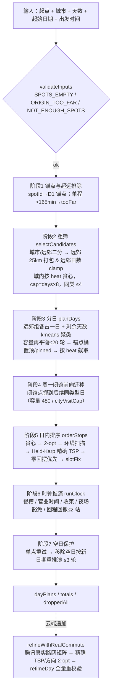

# 点定旅途 · 算法与数据素材

> 素材定位：简历/作品集「素材 B：路线算法、数据策略与质量验证」。
> 口径说明：本文所有数字均为 2026-10-19 在仓库当前工作区（HEAD `84cde7d`）**只读实测/逐项复核**，不是照抄旧文档；
> 代码行号基于当前文件版本（`engine/index.js` 730 行、`engine/test.js` 277 行）。凡旧文档口径与代码不一致处，均标注「文档口径」并汇总进 §8。

---

## 1. 算法总览

### 1.1 输入与输出

| 输入 | 约束 | 位置 |
|---|---|---|
| `origin` | `{name,lng,lat,spotId?}`，用户搜索选中的真实地点；`spotId` 命中库内景点时触发「锚点」规则 | `engine/index.js:562-567` |
| `days` | 1–5 天（云端 `Math.min(5, Math.max(1, days))`） | `cloudfunctions/genRoute/index.js:16`；`engine/index.js:568` |
| `startDate` | `YYYY-MM-DD`，用于周一闭馆判定、餐食/营业时间文案 | `engine/index.js:32-41` |
| `startMin` | 首日出发时间，可选 05:00–16:00，默认 09:00 | `engine/index.js:15-16,563-567` |
| `spots` | 城市景点库数组（60 城、2713 点，见 §3） | `cloudfunctions/_shared/routeKit.js:10-26` |

输出 `{city, days, startDate, origin, dayPlans[], totals, droppedAll[]}`（`engine/index.js:684-697`）：

- `dayPlans[i].items[]` 是「通勤 / 景点 / 餐食」交错的时间轴，类型只有 `start | commute | meal | stop | end`（`engine/index.js:467,475,510,518,554`）；
- `totals = {km, stops, visitMin, commuteMin}`（`engine/index.js:677-682`）；
- `droppedAll[].cause` 共 5 类：`周一闭馆 | 时间排不下 | 回程太晚 | 太远，当天往返不现实 | 候选溢出`（`engine/index.js:691-696`）。

### 1.2 七阶段主流程



| 阶段 | 函数 | 做什么 | 位置 |
|---|---|---|---|
| 输入校验 | `validateInputs` | 3 个业务错误码；云端在 `genRoute` 之前调用，浏览器 loading 页也直接调用同一份 bundle | `engine/index.js:704-728`；`cloudfunctions/genRoute/index.js:30`；`web/loading.html:180-185` |
| ① 锚点与超远排除 | `genRoute` 内联 | 起点=库内景点→锚点（周一闭馆则降级为纯坐标）；逐点单程估时 >165min 判「太远」 | `engine/index.js:574-585` |
| ② 粗筛 | `selectCandidates` | 城市/远郊分流、远郊按 25km + 480min 打包、远郊日数、城内候选与分类上限 | `engine/index.js:62-95` |
| ③ 分日 | `planDays` | 远郊组一日一组；剩余天数 kmeans 聚城内点；容量再平衡；锚点桶置顶并 `pinned`；按 heat 截取前 `days` 桶 | `engine/index.js:141-207` |
| ④ 周一闭馆迁移 | `genRoute` 内联 | 周一桶内闭馆点前向迁移到后续同类型桶，容量不足则交给时钟推演上报 | `engine/index.js:612-629` |
| ⑤ 日内排序 | `orderStops` / `slotFix` | 贪心最近邻 → 2-opt → 环线扫描 → 精确开放路径 TSP → 按「回摆数→代价」择优 → 时段修正 | `engine/index.js:342-415` |
| ⑥ 时钟推演 | `simulateDay` / `runClock` | 周一过滤、餐槽、营业时间等待/跳过/缩短、收束与到家上限、夜场豁免、回程太晚回撤 | `engine/index.js:438-558` |
| ⑦ 空日保护 | `genRoute` 内联 | 0 站日先用当日被裁点中 heat 最高者单点重试；仍空则移除该日，日期前移后重新推演（≤3 轮收敛） | `engine/index.js:631-656` |
| 组装 | `genRoute` 尾部 | 日主题（方位·主题线）、totals、droppedAll 汇总 | `engine/index.js:658-697` |

> 文档口径：`docs/route-planning-scheme.md:18-26` 也把主流程写成 7 步，但把「云端 refine」「组装」也算进流程；本文按代码实际执行顺序拆分，云端 refine 单列在 §1.4。

### 1.3 输入校验（三个业务码）

| code | 触发条件 | 用户可见文案（产品语气） | 位置 |
|---|---|---|---|
| `SPOTS_EMPTY` | 城市库过滤后无有效坐标 | 「这座城市的数据还没准备好，换座城市试试。」 | `engine/index.js:710-712` |
| `ORIGIN_TOO_FAR` | 最近景点 > **30km** | 「这个起点离可玩的地方有点远（最近景点约 N 公里）。换个起点试试。」 | `engine/index.js:713-719` |
| `NOT_ENOUGH_SPOTS` | **60km 内可用景点数 ≤ 天数**（是 ≤，不是 <） | 「这里目前收录了 N 个景点，排不满 D 天。减少天数，或换座城市。」 | `engine/index.js:720-726` |

### 1.4 云端二次精排（产品在线链路的第 8 步）

本地引擎用直线估算通勤；云端再补一次真实路网精排：`genRoute` 云函数先 `engine.genRoute()`，再 `refineWithRealCommute()`（`cloudfunctions/genRoute/index.js:34,45`）。

- 取数：每模式/每天 1 次腾讯距离矩阵，全对时长一次拿全；矩阵不可用时用统一 km 折算（≈24km/h），绝不用分段估算分钟（`cloudfunctions/_shared/routeKit.js:392-419`）；
- 排序：真实分钟矩阵上做 Held-Karp 精确 TSP（含方向 2-opt、商圈首站偏好 ≤5min），夜间项目硬压尾；最后 `retimeDay` 全量重校验时间窗/餐/收束/回程（`routeKit.js:421-447`）；
- 成本红线：单条路线腾讯调用 ≤15 次；冷缓存 3 日典型 6–8 次（`docs/route-planning-scheme.md:4,81`；`routeKit.js:2-4`）。

### 1.5 工程形态

- `engine/` 为纯 JS、零依赖：`index.js` 730 行 / `geo.js` 73 行 / `copy.js` 83 行 / `test.js` 277 行；
- 同一份源码被三端复用：Node 测试、云函数、浏览器 bundle（`scripts/build-engine-bundle.js:3-12` 打包，产物 `web/assets/engine.bundle.js`，当前 39,630 字节）；
- 算法与 AI 的边界：**排序永远由算法完成，AI 只写文案**；`engine/` 模块本身不调用任何外部 API（开发期直线估算），线上通勤数据由云函数用腾讯矩阵注入，但排序规则仍由算法决定；运行时禁止调用高德（`engine/index.js:2-4`；`docs/route-planning-scheme.md:79`）。
- 浏览器端也直接复用同一份引擎：loading 页本地跑 `validateInputs`/`genRoute`（`web/loading.html:180-220`），结果页本地重排（`web/result.html:525`），微调用 `retimeDay`（`web/assets/app.js:343`）。

---

## 2. 关键规则与常数表

> ⚠ 重要更正：任务说明/旧文档里的「`MAX_STOPS_PER_DAY=5`、`MAX_PER_CAT=3`」已被迭代：**当前代码是 8 和 4**（`engine/index.js:13-14`，浏览器 bundle 同步为 8/4，实测 bundle 第 182-183 行）。
> 旧值出处：`项目上下文.md:157-158`、`docs/spot-library-rules.md:127`（均为过时口径）。

| 规则 | 值 | 代码位置 | 一句话产品含义（为什么这样定） |
|---|---|---|---|
| 日出发/收束 | 09:00 / 19:30 | `engine/index.js:9-10` | 默认按「早上出门、晚饭前收」的游客节奏排，末站游览不得超过 19:30 |
| 到家上限 | 市区 21:00；远郊 21:45 | `engine/index.js:460-462` | 回程过晚触发回撤，宁可少一站也不让用户深夜还在路上 |
| 午餐槽 | 11:30 起、最晚 13:00 开始、60min | `engine/index.js:11,471-486` | 时间轴里午餐是硬块，不会出现「饿着逛到 15 点」 |
| 晚餐槽 | 17:30 起、最晚 18:30 开始、60min | `engine/index.js:12,479-486` | 保证一天以晚饭收尾，也解释「为什么 19:30 前要收」 |
| `MAX_STOPS_PER_DAY` | **8** | `engine/index.js:13` | 上限只用于候选容量（`days×8`）与兜底；实际每天 3 站左右（§5.2 实测均值 2.97），不赶场 |
| `MAX_PER_CAT` | **4** | `engine/index.js:14` | 粗筛按品类去重，避免一天全排博物馆；放宽到 4 是为「一天多玩几处」的新版产品目标 |
| 城内候选上限 | `days × 8` | `engine/index.js:82-92` | 候选池保持宽松：收太紧会让稀疏方向的高热点（如熊猫基地）无法单独成簇 |
| 远郊打包半径 | 25,000m | `engine/index.js:17,66-73` | 远郊点互相 25km 内视为同一日可打包，避免一天横跨两个县 |
| 远郊单日游览上限 | 480min | `engine/index.js:18,71` | 远郊通勤长，游览总量封顶 8 小时 |
| 远郊日数节制 | `min(max(days-2,0),3)` | `engine/index.js:78-80` | 1–2 日全留市区；3 日给 1 个远郊日；5 日最多 3 个，防止「全在城外跑」 |
| 「太远」排除 | 单程估时 >165min | `engine/index.js:19,579-585` | 当天往返不现实就诚实排除并进未排入清单，不硬塞进行程 |
| 起点校验 | 最近景点 >30km；60km 内点数 ≤ 天数 | `engine/index.js:20-21,704-728` | 起点太偏/城市库太薄时在入口拦截，省掉一次无效生成 |
| 出发时间可选范围 | 05:00–16:00（clamp） | `engine/index.js:15-16,563-567` | 用户可以选「赶早」或「睡到下午」，但超出范围会被夹回 |
| 单日游览容量 | `max(480, min(720, (19:30-startMin)-60))` | `engine/index.js:586-588` | 早出发放宽容量、晚出发收紧，空出 60min 餐食+缓冲 |
| 锚点规则 | 起点命中库内景点→置顶 + `pinned` D1 首站；周一闭馆则降级 | `engine/index.js:574-577,180-198` | 用户「从我住的/我选的景点出发」必须被尊重，第一站可预期 |
| 闭馆迁移容量 | 远郊 480min / 市区 `cityVisitCap`（默认 570，随出发时间 480–720） | `engine/index.js:586-588,612-629` | 周一闭馆点尽量前向迁移而不是直接丢，保护高热度博物馆 |
| 容量再平衡 | 最多 **20 轮**，超限桶把最低 heat 点让给最近同类桶 | `engine/index.js:156-177` | 把单日游览总量压回上限；没有同类桶接收则交给时钟按「排不下」剔除 |
| 跨天再平衡 | 12 轮、阈值 −1.5km（`rebalanceBuckets`） | `engine/index.js:113-139` | 设计意图是减少「跨区拼日」；**注意：当前 `genRoute` 未调用此函数（死代码，见 §8）** |
| 精确开放路径 TSP | Held-Karp，`n>8` 返回 null | `engine/index.js:228-270` | ≤8 站用精确解兜底，消除贪心/2-opt 的局部最优 |
| 2-opt | 最多 40 轮，代价下降 >5m 才接受 | `engine/index.js:417-434` | 在候选排序上做局部改进；pinned 首站不参与反转 |
| 环线扫描 | 按相对起点方位角顺/逆时针 × 各旋转起点 | `engine/index.js:211-225` | 一日环线最直观的几何解，避免「南→东→西」折返 |
| 排序代价函数 | 直线距离 + 交叉×600m + 原路折返×900m + 方位回摆×500m + 连续折返×350m | `engine/index.js:286-340`（惩罚常数 `:287,339`） | 用「多绕 600m 也不许一次交叉」把路线推向单向环线，地图观感顺 |
| 零回摆优先 | 先比回摆次数，再比代价；代价劣化 >20%+1km 退回代价最优 | `engine/index.js:378-387` | 观感优先于纯最短里程，但设安全阀防止绕路 |
| 时段修正 `slotFix` | 「早去/赶早」前移；`cat=夜景/演出` 或 `tags=夜游/夜市/看演出/灯光秀` 硬压尾 | `engine/index.js:393-415` | 夜景留给灯亮之后；「早去」只是软约束（绕路 >8% 放弃） |
| 通勤估算 | 直线×1.3；<1.5km 步行 4.5km/h；<15km 公交 16km/h×1.2；<60km 打车 32km/h；更远 45km/h | `engine/index.js:50-58` | 开发期离线可算；线上由腾讯矩阵替换（`retimeDay` 注入 commute 函数） |
| 营业时间 | 早到等待；来不及入场跳过；剩余 ≥45min 可缩短游览至关门 | `engine/index.js:496-508` | 时刻表永远落在真实可入园区间，不会「闭馆后到达」 |
| 纯夜场豁免 | `open` 起始 ≥17:00 的场次允许演到散场，不受 19:30 收束 | `engine/index.js:505-506` | 演出/夜游这类项目必须能排进夜场，否则会被收束误杀 |
| 美食顶替餐槽 | `cat=美食` 且落在饭点 → 记为已用餐，不插独立餐槽 | `engine/index.js:513-517` | 用户吃饭时逛美食街，时间轴上不出现「双份午餐」 |
| 回程太晚回撤 | 从末尾最多撤 2 站 | `engine/index.js:538-550` | 用「少一站」换「按时回酒店」，并记录 dropped 原因 |
| 空日保护 | 单点重试 → 移除空日 → 按新日期重推演 ≤3 轮 | `engine/index.js:631-656` | 结果里不出现空白天；日期前移后周一口径会变，所以必须重推演 |
| 日颜色 | 5 色循环（`#3B7356/#3E8E9E/#B08A3E/#7A9E43/#8C6A4A`） | `engine/index.js:23` | 地图/时间轴按天着色，5 天以上循环复用 |
| 热度徽章 | `heat≥9`「热门」；`heat<8`「宝藏」；`heat=8` 无徽章 | `engine/copy.js:10-14` | 列表卡片上快速表达「值不值得去」，不暴露算法分 |
| 日主题标签 | 类目 heat 加权最高者映射「文博/山水/…」+ 方位质心 | `engine/copy.js:4-8,32-43` | 如「西南 · 公园线」，是模板不是 AI，保证可解释 |

---

## 3. 数据资产盘点

### 3.1 规模总表（实测）

| 项 | 数值 | 来源/口径 |
|---|---|---|
| 城市总数 | **60** | `data/cities.json`（`cities` 数组 60 条，7 大区） |
| 上线城市数 | **60**（`status` 全为 `done`） | `data/cities.json`：`status: done=60`，`_meta.launched=60`、`launched_at=2026-10-17` |
| 有景点数据文件的城市 | **60** | `data/spots/<file>.json`，与 `data/library-v1.json` 的 60 城一一对应 |
| 景点总量 | **2,713** | 逐文件计数，与 `data/library-v1.json` 的 `totals.points=2713` 完全一致 |
| `data/spots/` JSON 文件总数 | **402** = 60 城市库 + **342** 报告文件 | 报告按类型：enrich 60 / rebuild 60 / rebuild-apply 60 / rule-audit 60 / biz 22 / coord-repair 22 / rebuild-pool 22 / rematch 22 / add 6 / backfill 6 / 全局 2 |
| 版本戳 | `v1`，2026-10-17 | `data/library-v1.json`（`version/date/updated_at`） |

### 3.2 各城景点数分布

Top 10（含并列；城市:点数/远郊数）：

| 排名 | 城市 | 点数 | 其中远郊 |
|---|---|---|---|
| 1 | 重庆 | 64 | 16 |
| 2 | 北京 | 60 | 11 |
| 3 | 宁波 | 58 | 19 |
| 4 | 杭州 | 56 | 7 |
| 5 | 成都 | 55 | 19 |
| 6 | 广州 | 54 | 16 |
| 6 | 西安 | 54 | 12 |
| 8 | 上海 | 53 | 17 |
| 9 | 苏州 / 厦门 | 52 / 52 | 10 / 2 |
| 10 | 南京 | 51 | 7 |

区间统计（60 城）：

| 每城点数 | 城市数 | 代表城市 |
|---|---|---|
| < 30 | 3 | 喀什 24、敦煌 27、西双版纳 29 |
| 30–39 | 5 | 凤凰 33、婺源 34、香格里拉 34、三亚 38、兰州 38 |
| 40–49 | 38 | 多数城市（均值 45.2） |
| 50–59 | 12 | 重庆/北京/宁波/杭州/成都等 |
| ≥ 60 | 2 | 重庆 64、北京 60 |

口径说明：`docs/spot-library-rules.md:43` 目标「每城 45–65」，`:46` 允许小城 ≥20；当前 8 城低于 40（均为供给有限的小城或特殊目的地），属该例外。

### 3.3 单景点字段结构（样板：`data/spots/chengdu.json` 第 1 点）

样板点 38 个字段；全库并集 43 个字段（含历史/审计字段）。核心字段：

```json
{
  "id": "panda-base", "name": "成都大熊猫繁育研究基地", "cat": "亲子",
  "tags": ["熊猫", "早去", "园区大"], "heat": 9, "dur": 210,
  "intro": "全球最大熊猫迁地保护基地，可看各年龄段熊猫。",
  "reason": "九点前到，熊猫最活跃人也最少",
  "open": "07:30-18:00", "open_text": "03-16至10-31 …", "closed_mon": false,
  "suburb": false, "coord": [104.138176, 30.740573], "coord_src": "amap",
  "amap_poi_id": "B001C7WE5S", "verify_src": "amap", "verified_at": "2026-10-17",
  "rating": 4.8, "a_level": "4A", "keytag": "4A景区",
  "entrance": [104.143966, 30.727906], "navi_poiid": "…",
  "photo": "…", "photos": ["…"], "tel": "028-83510033", "address": "熊猫大道1375号",
  "district": "成华区", "adcode": "510108", "business_area": "熊猫基地"
}
```

字段分组与用途：

| 字段组 | 字段 | 引擎/产品用途 |
|---|---|---|
| 身份 | `id` / `name` | `id` 分享链接与反馈引用；`name` 与高德官方名一致（`docs/spot-library-rules.md:12-14`） |
| 筛选 | `cat`（11 类）/ `heat`（5–9）/ `suburb` / `tags` | 粗筛分类上限、分组排序、远郊分流；`tags` 的「早去/夜游」被 `slotFix` 消费 |
| 时间 | `dur` / `open` / `open_text` / `closed_mon` | 时钟推演核心：游览时长、营业窗口、周一闭馆 |
| 空间 | `coord`（[lng,lat] GCJ-02）/ `coord_src` / `entrance` / `navi_poiid` | 距离/聚类/地图定位；入口坐标比 POI 中心更准（`docs/spot-library-rules.md:26`） |
| 质量背书 | `rating` / `a_level` / `keytag` / `amap_poi_id` / `verify_src` / `verified_at` | 建库规则（评分 <4.0 删）、A 级景区豁免、可复验 |
| 内容 | `intro` / `reason` / `photo` / `photos` / `copy_src` | 卡片与海报文案/配图；`copy_src='ai'` 标记 AI 文案 |
| 运营 | `address` / `district` / `adcode` / `business_area` / `tel` / `cost` / `website` | 详情展示、导航、分享海报 |

### 3.4 分类 / 热度 / 时长分布（实测 2,713 点）

| 分类 | 点数 | 占比 |
|---|---|---|
| 山水 | 931 | 34.3% |
| 古迹 | 470 | 17.3% |
| 公园 | 294 | 10.8% |
| 街区 | 291 | 10.7% |
| 博物馆 | 272 | 10.0% |
| 亲子 | 146 | 5.4% |
| 古镇 | 128 | 4.7% |
| 夜景 | 55 | 2.0% |
| 美食 | 52 | 1.9% |
| 商圈 | 43 | 1.6% |
| 演出 | 31 | 1.1% |

| heat | 点数 | 说明 |
|---|---|---|
| 9 | 94 | 「热门」徽章 |
| 8 | 427 | 无徽章 |
| 7 | 1,954 | 「宝藏」徽章（<8） |
| 6 | 237 | 「宝藏」 |
| 5 | 1 | 「宝藏」 |

- `dur`：实测 35–420min，众数为 180min（882 点）、120min（543）、90min（509）；缺失按 90min 兜底（`engine/index.js:495`）。
- `rating`：覆盖率 100%，min 3.0 / max 5.0 / 均值 4.58；≥4.5 共 2,167 点（80%）。
- `suburb`：592 点（21.8%）；`docs/spot-library-rules.md:28` 口径：距城市中心 >25km 视为远郊。

### 3.5 `heat` 的构成（关键结论）

`heat` 不是人工打分，而是建库脚本按评分/景区等级推导，再 clamp 到 5–10：

```
score = 0.6·norm(rating) + 0.25·level        (rebuild-library.js:67-72)
norm(rating) = clamp((rating−3.5)/1.5, 0, 1)
level ∈ {national:1, province:0.6, city:0.3, 其他:0}
heat = clamp(round(5 + 5·score), 5, 10)      (rebuild-library.js:74；build-city.js:71-77)
```

- 规则文档还含 `0.15·curation` 人工策展项（`docs/spot-library-rules.md:19`），但当前写库脚本 `curation` 恒为 false → **实际 heat 取值 5–9，达不到 10**；
- `heat` 只参与「选哪些点、哪组优先级、空日重试」；**不参与日内顺序、不进任何时长/里程公式**（`项目上下文.md:182-185`；`orderStops` 内不读 heat，`engine/index.js:342-389`）；
- 与 `fame/iconic` 的关系：`fame.json`（38 城、178 个必留名，1–10/城）只用于**豁免删除**与「必留」判定，不直接改 heat；`iconic.json`（60 城、433 个标志性关键词）用于补录缺口位的检索词，也不参与排序。

### 3.6 完整度指标（实测覆盖率）

| 指标 | 数量 | 占比 |
|---|---|---|
| 坐标来自高德（`coord_src=amap`） | 2,713 / 2,713 | **100%**（`estimate`=0、`tencent`=0） |
| 评分 `rating` | 2,713 | 100% |
| 首图 `photo` | 2,713 | 100%（多图 `photos` 2,682 点） |
| 官方名核验 `verify_src/verified_at` | 2,713 | 100% |
| A 级景区标注 `a_level` | 675 | 24.9%（5A 126 / 4A 444 / 3A 105） |
| 营业时间 `open` | 2,139 | 78.8% |
| 闭馆日明确 `closed_mon` 非 null | 2,218 | 81.7%（其中 `true` 143 点=5.3%，未知 495 点=18.2%） |
| 入口坐标 `entrance` | 2,549 | 93.9% |
| 电话 `tel` | 1,813 | 66.8% |
| 地址 `address` | 2,681 | 98.8% |
| AI 文案 `copy_src='ai'` | 1,506 | 55.5%（其余为手写/模板） |
| `tags` 为空 | 1,172 | 43.2%（非必填） |

### 3.7 已知数据问题（写简历时要避开或如实说明）

- **`id` 有 9 组跨城重复**（如 `jingshan` 同时是北京/温州景山公园、`zoo` 北京/成都动物园、`drum-tower` 宁波/西安鼓楼）→ 不能说「全局唯一 ID」，正确说法是「城市内唯一短 id」（`项目上下文.md:396`）；
- `name` 有 25 组跨城同名（景山公园/人民公园/文昌阁等），**同城重名 0 组**（QA 通过）；
- 分类里仍有 **31 条 `cat=演出`**（17 城：大剧院/音乐厅等场馆 + 印象系列等目的地夜演）。规则文档「演出类一律删」指的是《》/沉浸式/戏剧等**产品名**（`docs/spot-library-rules.md:63-64`；`rebuild-library.js:206,231`），场馆与夜演属「夜间目的地」保留；
- **10 城远郊点 <4**（`docs/spot-library-rules.md:42` 目标 ≥4）：厦门 2、福州 3、北海 3、天津 2、太原 1、武汉 1、洛阳 3、开封 2、喀什 2、长春 1；
- 组成体检（`node scripts/rebuild-library.js --audit`）实测 **31/60 城零缺口**，其余 29 城的缺口主要来自「5A/4A/FAME/≥4.5 豁免配额」（`docs/spot-library-rules.md:45`），其次是上述远郊不足与核心类占比；不能宣称「60 城全部达标」；
- `closed_mon` 未知 18.2%：引擎对未知博物馆会输出「闭馆日未核实，建议出发前确认」（`engine/copy.js:24-26`），不能说「闭馆信息 100% 准确」。

---

## 4. 数据生产流水线（POI → 上线）

```mermaid
flowchart LR
  A[高德 POI 发现<br/>build-city: 10 轮关键词 around] --> B[规则筛选<br/>类型/店铺/状态/评分≥4.0]
  B --> C[去重 + 子点聚类<br/>名称互相包含 / 1.5km+3字前缀]
  C --> D[类目配额配平<br/>GROUPS max + 远郊补 4]
  D --> E[文案<br/>LLM + 模板回退 → upgrade-copy 批量升级]
  E --> F[写库 + 注册表 + FAME 种子]
  F --> G[富化 pipeline<br/>repair-coords → rematch-llm → biz-info]
  G --> H[库重构 rebuild --collect/--plan --apply<br/>删演出/低分/配额/FAME/heat 重算]
  H --> I[逐点规则审计 --audit-rules --apply<br/>官方名/评分/删除清单]
  I --> J[上线：cities.json + routeKit CITY_FILES<br/>+ 前端数据文件 + 云函数部署]
```



| 步骤 | 脚本（关键逻辑位置） | 输入 | 产出 | 人工校验点 |
|---|---|---|---|---|
| ① 发现候选 | `scripts/build-city.js:126-166`：行政区中心点 → 10 组关键词 `around`（风景名胜/博物馆/公园/古镇/主题乐园/文化街区/美食街/寺/山/湖，半径 2–5 万米，weight 排序） | 城市名 | 候选 POI 集合（累计） | 抽查候选是否混入店铺/子设施 |
| ② 规则筛选 | `build-city.js:167-186`：`PLACE_TYPE` 白名单 + `BAD_TYPE`/`SHOP_NAME`/`STATUS_PAREN` 黑名单 + 名称长度/连字符 + `rating≥4.0` | 候选 POI | 合规候选 | 无评分/低分点是否被误杀 |
| ③ 去重/收口 | `build-city.js:187-205`：名称互相包含取高分；同景区 1.5km 内且 ≥3 字前缀相同视为子点只留高分 | 合规候选 | 去重后集合 | 子点是否被降级成上位景点 |
| ④ 配额配平 | `build-city.js:27-35,206-223`：`GROUPS`（核心 26–34/夜景 4–8/亲子 4–7/街区≤8/美食≤4/公园≤5/商圈≤2）+ 远郊补足 4 | 去重集合 | 入选清单 | 配额例外（A级/FAME）是否合理 |
| ⑤ 文案 | `build-city.js:101-125` LLM（≤45 字 intro、≤24 字 reason，禁数字/票价/夸张词），失败回退模板 `:79-100`；存量批量升级 `scripts/upgrade-copy.js:13-41,103-118`（8 条/批，整批校验失败再单条重试 3 次） | 景点事实（名称/类目/城内城郊/时长/评分） | `intro/reason` + `copy_src='ai'` | 抽查是否编造典故/数字；同批开头重复会被丢弃（`:75-77`） |
| ⑥ 写库/登记 | `build-city.js:237-270`：生成稳定短 id（file+normName 的 md5 前 8 位）、写 `data/spots/<file>.json`、登记 `data/city-registry.json`、`data/fame.json` 种子 | 入选清单+文案 | 城市库 + 注册表 + FAME | 只允许 `--apply` 写盘；已建库城市拒绝重跑（`:153`） |
| ⑦ 富化/补全 | `scripts/pipeline.js:1-7`：①`repair-coords` 坐标修复 → ②`rematch-llm` LLM 别名裁判 → ③`biz-info` 官方名/营业信息/POI 校准 → ④`rebuild --collect` 候选池 → ⑤`rebuild --plan --apply` 重构 → ⑥校验（heat 越界/坐标/重名/残留演出类，不达标 exit 1） | 城市库 | 各步 `*.coord-repair-report.json`、`*.rematch-report.json`、`*.biz-report.json`、`*.rebuild-report.json` | 报告逐条留痕；`biz-audit.js --revert` 定向回滚可疑改名/坐标 |
| ⑧ 规则审计 | `scripts/rebuild-library.js:290-403`：逐点按 `amap_poi_id` 取高德实体，检查 ①名称是否官方名 ②评分<4.0 是否该删 ③无评分非知名是否该删，产出 renames/deletes/ratingUpdates/noPoi 四清单，`--apply` 才落盘 | 城市库 | `*.rule-audit-report.json` | 复合名只接受完整包含的官方名（`:359-364`）；子设施/店铺名不采信（`:302-304,357-358`） |
| ⑨ 上线 | `data/cities.json`（status/launched）、`cloudfunctions/_shared/routeKit.js:10-26`（真正决定能否生成的 `CITY_FILES`）、前端 `web/assets/app.js` 白名单三处同步 | — | 线上 60 城 | 三处白名单一致性（`项目上下文.md:384-388` 的旧口径已迭代到 60 城） |

**各步的「防错设计」**（可写进简历的工程细节）：

- 坐标修复不用「搜索命中就覆盖」，而是**双源互证**：两服务商坐标 ≤300m（远郊 600m）才落盘；第二档 ≤1000m 且名称完全相等（远郊 1500m）；只用高德模式要求名称完全相等 + 位移 ≤20km，防同名异地（`scripts/repair-coords.js:17-24,264-340`）；
- LLM 裁判只允许「在候选里挑一个或全否」，幻觉无法引入新地点；**裁判不可用（null）≠ 否决**，前者保留待人工、后者才允许删除（`rematch-llm.js:40-61`；`repair-coords.js:60-69,306-323`）；
- 事后审计 `biz-audit.js` 用可疑名正则（洗车/便利店/售票处/停车场/餐厅…）找回原值并可 `--revert`，避免为几个坏例重跑整城（`scripts/biz-audit.js:3-10,23-49`）；
- 所有批量脚本默认**干跑（dry-run）**，写盘必须显式 `--apply`；报告按 id 合并留痕，不被下一次运行冲掉（`repair-coords.js:12,248-258`）。

---

## 5. 质量验证体系

### 5.1 引擎单测 `engine/test.js`（实测全绿）

- 规模：277 行；**14 组场景 + 2 组专项块 = 16 个执行块**；`node engine/test.js` 实测 `exit 0`、0 失败（16 个执行块输出「✓ 校验通过」，加末尾总结行共 17 处）；
- 通用校验器 `validate()` 覆盖 **11 类断言**（`engine/test.js:14-84`）：天数一致、餐槽不重叠、站间时间不重叠、时长非法、早于开门、晚于关门、周一闭馆仍排入、超过收束、远郊市区混日（>25km）、锚点须为 D1 首站、空日（0 站）；
- 场景矩阵（`engine/test.js:115-210`）：成都 1/3/5 日、起点=景点（熊猫基地锚点）、周一起始闭馆压力、北京 3 日、北京周一起始（故宫）、重庆/杭州/上海/西安 3 日、杭州 5 日（千岛湖 >165min 排除 + 空日保护）、北京锚点=故宫且周一起始（锚点闭馆降级）、成都周一起始（合成数据验证闭馆前向迁移）；
- 专项块：D 微调重推演（交换/删除/+15min 保序 + 约束复核，`engine/test.js:214-238`）；G 输入校验三条规则（`engine/test.js:240-256`）。

### 5.2 全量离线回归（本次实测，60 城 × 1/3/5 天）

| 指标 | 实测值 |
|---|---|
| 生成路线数 | **180**（60 城 × 3 种天数），平均耗时 ~2.5ms/条，最慢 17ms，总计 449ms |
| 生成天数 | 540 天；空日 **0**；校验问题 **0**（含 validateInputs 全通过） |
| 总排入站点 | 1,602 站，**日均 2.97 站**，单日最多 8 站（仅 1 天达到 8） |
| 单日站数分布 | 1 站 67 天 / 2 站 133 / 3 站 145 / 4 站 151 / 5 站 36 / 6 站 7 / 8 站 1 |
| 未排入合计 | 2,035 条：`时间排不下` 1,912（93.9%）、`太远，当天往返不现实` 99、`回程太晚` 24；无 `候选溢出` |
| 太远排除分布 | 14 城有「太远」点：拉萨 21、重庆 15、大理 12、香格里拉 12、丽江 9、杭州 6、昆明 3… |

> 口径：起点取各城 `cities.json` 的 `center`（市中心），起始日期取周二（2026-10-20），因此本批不触发周一闭馆路径；通勤为直线估算，非线上真实路网。

### 5.3 排序质量基线 `scripts/qa-order.js`

12 城 × 1/3/5 天（成都/杭州/北京/上海/西安/苏州/武汉/长沙/广州/厦门/青岛/昆明，`qa-order.js:5`），实测输出（`node scripts/qa-order.js`）：

- **87 个游玩日**；顺序达到「开放路径最优 ±2%」**47 天（54%）**；
- 平均差距 **2.37km**；方向回摆总数 **14**；跨度 >40km 的「跨区日」 **0**。

> 与 `docs/route-planning-scheme.md:173` 的基线数字**逐项一致**（87 天/回摆 14/跨区 0/平均差 2.37km），说明该基线可复现；但它是脚本化基线，未接入 CI 卡口。

### 5.4 库组成体检 `rebuild-library.js --audit`（零配额，可随时跑）

实测 60 城：**31 城完全达标**，29 城存在缺口；缺口集中在：远郊点 <4（10 城，见 §3.7）、超配额类目（公园/商圈/街区，多因 A 级/FAME/≥4.5 豁免而保留）、核心类占比 <60%（成都 47%/北京 48%，同样是受限类目豁免后基数变大所致）。该体检不阻断发布，只作运营看板。

### 5.5 数据完整性核验（本次逐项）

- `coord_src=amap` 2,713/2,713（100%），`estimate` 0——V1 定版「估算坐标 0」成立（`docs/spot-library-rules.md:114`）；
- `rating/photo/verify` 覆盖率 100%；`a_level` 675（5A 126/4A 444/3A 105）与 `library-v1.json`、规则文档 `:116` 完全一致；
- 同城重名 0；`closed_mon=true` 仅 143 点（5.3%），与周一闭馆迁移逻辑的样本量匹配；
- 云函数回归：`scripts/test-functions.js` 共 **37 个 `check()` 断言**，覆盖 genRoute（lat 缺失/越界/未开通城市/起点太远/合法请求/落库/限频）、reRoute（空 stops 返回 200 空日、合法请求）、feedback（内容校验/routeId 格式/落库失败 500）、routePaths（抽稀 ≤3 点/首尾保留/L 形拐点、端头吸附 ≤120m、幂等、误差 ≤6/8/12m）、云端再优化（分组约束/第 1 站钉住/守卫阈值）等。

### 5.6 历史审计日志（仅作过程证据，不含当前结论）

`build/` 下有 2026-10-17 的中间态审计日志：`audit22.log`（22 城）、`audit60.log`（60 城首轮）、`audit-v1.log`（A 级规则审计）、`rule-audit.log`（规则审计应用）。**这些日志里的城市点数（如成都 61/62 点）与当前库（55 点）不同**，只能证明「当时做过全量审计」，不能当现在的数字引用。

---

## 6. 可量化数字表（简历用，≤20 条）

| # | 指标 | 数值 | 统计口径/来源 |
|---|---|---|---|
| 1 | 覆盖城市 | **60 城**（7 大区，全部上线） | `data/cities.json`（60 条、status=done、launched=60） |
| 2 | 精选景点库 | **2,713 点** | 60 个 `data/spots/*.json` 逐文件计数 = `library-v1.json` totals |
| 3 | 单城规模 | 平均 **45.2** 点；最少 24（喀什）/最多 64（重庆） | 逐文件计数 |
| 4 | 数据文件总量 | **402 个 JSON**（60 城市库 + 342 报告） | `data/spots/` 文件分类统计 |
| 5 | 坐标可信度 | **2,713/2,713 高德坐标（100%）**，估算坐标 **0** | 字段 `coord_src` 逐点统计 |
| 6 | 评分/图片覆盖 | 评分 100%（均值 4.58）、首图 100% | 字段 `rating` / `photo` |
| 7 | A 级景区 | **675 个**（5A 126 / 4A 444 / 3A 105） | 字段 `a_level` |
| 8 | 营业时间/闭馆日 | 营业时间 78.8%；闭馆日明确 81.7%（周一闭馆 143 点） | 字段 `open` / `closed_mon` |
| 9 | 远郊点 | **592 点（21.8%）** | 字段 `suburb` |
| 10 | AI 文案占比 | **1,506 条（55.5%）** | 字段 `copy_src='ai'` |
| 11 | 引擎代码规模 | 4 文件 **1,163 行**（index 730/geo 73/copy 83/test 277），**0 依赖** | 文件行数 |
| 12 | 引擎单测 | **16 个场景块、11 类断言、0 失败**（exit 0） | `node engine/test.js` 实测 |
| 13 | 全量离线回归 | **60 城 × 1/3/5 天 = 180 条路线 / 540 天 / 0 空日 / 0 问题** | 本次脚本实测 |
| 14 | 单日节奏 | 日均 **2.97 站**，上限 8 站（仅 1 天触顶） | 180 条路线统计 |
| 15 | 引擎性能 | 平均 **~2.5ms/条**，最慢 17ms（180 条合计 449ms） | 本次脚本实测 |
| 16 | 排序基线 | 87 个游玩日：最优率 54%、均差 2.37km、回摆 14、跨区日 0 | `node scripts/qa-order.js` |
| 17 | 云函数回归 | **37 个断言**覆盖 4 个函数 + 路网几何处理 | `scripts/test-functions.js` |
| 18 | 规则参数 | 3 类输入校验码 / 5 类未排入原因 / 11 个景点分类 | `engine/index.js` |

---

## 7. 算法规则 → 产品规则翻译表

| # | 技术规则（代码） | 产品/体验规则（用户感知） |
|---|---|---|
| 1 | 19:30 收束 + 市区 21:00 到家；远郊 20:30/21:45（`index.js:460-462`） | 「每天都能吃完晚饭、按时回酒店」——分享页敢写具体时刻，因为有硬上限兜底 |
| 2 | 午餐 11:30 起/晚餐 17:30 起，各 60min（`index.js:11-12`） | 时间轴固定显示餐食槽；用户不用自己算「几点该吃饭」 |
| 3 | 单日上限 8 站、动态容量、实际日均 2.97 站（`index.js:13,586-588`；§5.2） | 产品话术是「一天不赶场」，不是「一天 N 站」；站数是时间自然收敛的结果 |
| 4 | 单程 >165min 直接排除（`index.js:19,579-585`） | 对「太远」目的地诚实提示「当天往返不现实」，不硬塞一个 4 小时车程的点 |
| 5 | 起点 30km 内无点 / 60km 内点数 ≤天数 → 报错（`index.js:704-728`） | 选起点时即时拦截，文案给出可操作建议（换起点/减天数/换城市） |
| 6 | 周一闭馆点前向迁移 + 兜底 notice（`index.js:612-629`；`copy.js:21-29`） | 「周一闭馆」的博物馆不会被排进周一；日期前移后自动重推演，不出现「到了门口吃闭门羹」 |
| 7 | 起点命中库内景点 → D1 第 1 站 pinned（`index.js:180-198`） | 用户选的酒店/景点就是行程第一站，建立「它真的按我的选择排」的信任 |
| 8 | 远郊独立成日 + 远郊日数节制（`index.js:78-80,141-151`） | 「D3 赶早出城」的叙事；不出现「上午市区、下午 60km 外」的折腾日 |
| 9 | 交叉/折返/回摆惩罚 + Held-Karp 精确解（`index.js:286-340,228-270`） | 地图上是一条顺向环线，不来回穿城；分享海报的路线看着「像人排的」 |
| 10 | 「夜景/演出/夜游/夜市」硬压尾（`index.js:393-415`） | 夜游一定在灯亮之后；白天先看馆逛园子，晚上留给夜景 |
| 11 | 回程太晚从末尾撤站 ≤2 站（`index.js:538-550`） | 宁可少一站也不出现「22:30 还在路上」；未排入清单如实解释原因 |
| 12 | 空日保护 ≤3 轮（`index.js:631-656`） | 结果页永不出现空白天；某天排不满就自动收拢日期并重算周一口径 |
| 13 | 未排入清单 5 类原因（`index.js:691-696`） | 产品承诺「诚实」：排不进去的点明确告知原因（闭馆/太远/时间排不下/回程太晚/候选溢出） |
| 14 | AI 只写文案、不改顺序（`index.js:2-4`；`route-planning-scheme.md:79`） | 路线可解释、可复现；同一输入重排结果稳定，支持分享链接回看 |
| 15 | 日主题=方位+类目模板（`copy.js:32-43`） | 「西南 · 公园线」这类日标题零成本、不会幻觉，且与地图方向一致（该 bug 已修，`route-planning-scheme.md:171`） |

---

## 8. 存疑项（无法从仓库验证 / 不要写进简历）

> 原则：以下数字或说法要么已被当前代码推翻，要么只能从旧文档引用、无法用仓库数据复现。简历里使用前请向 Lead 确认，或改用本文 §6 的实测口径。

| # | 存疑/冲突项 | 实际情况 |
|---|---|---|
| 1 | `MAX_STOPS_PER_DAY=5`、`MAX_PER_CAT=3` | **已被推翻**：当前代码/浏览器 bundle 均为 **8 / 4**（`engine/index.js:13-14`）。旧值在 `项目上下文.md:157-158`、`docs/spot-library-rules.md:127`、任务说明中；写简历请用 8/4 或不提具体数字 |
| 2 | 「城内候选 cap = days×5」 | 旧口径（`项目上下文.md:143,200`）；当前 `cap = days × MAX_STOPS_PER_DAY = days×8`（`engine/index.js:84`） |
| 3 | 引擎 503 行 / test.js 266 行 / 2-opt「≤30 轮、delta>50m」 | 旧口径（`项目上下文.md:133,136,147`）；当前 730/277 行，2-opt「≤40 轮、>5m」（`engine/index.js:417-434`） |
| 4 | `rebalanceBuckets`「分日再平衡」已生效、并带来 QA 基线提升 | 函数已实现（12 轮、−1.5km 阈值，`engine/index.js:113-139`）但**当前 `genRoute` 未调用**；`docs/route-planning-scheme.md:167-173` 的归因无法从当前代码证实。可写「设计并实现过跨天再平衡模块」，不要写「已上线带来 X% 提升」 |
| 5 | 「60 城 × 1/3/5 天 QA 0 问题」 | 本文复现为 180 条路线 0 问题（§5.2），但为**离线直线估算**；线上真实路网可能产生额外 dropped/time-window 问题，不能等同线上 0 问题 |
| 6 | `heat = 5–10` | 文档口径（`docs/spot-library-rules.md:19`；`项目上下文.md:182`）；实测 **5–9**（无 10），因写库时 curation 恒 false。简历可写「5–9 热度分」 |
| 7 | 「22 城 1500 条 heat 全覆盖」「22 个城市文件」「done 恰为 6 城」 | 全部为旧中间态（`项目上下文.md:182,382,409`）；当前 60 城 / 60 文件 / 2713 点 / done=60 |
| 8 | `coord_src` 存在 tencent/estimate 混用（如成都 57/4/9） | 旧口径（`项目上下文.md:275,405-412` 的 2026-10-16 中间态）；当前 **2713/2713 全为 amap，estimate=0**，`docs/spot-library-rules.md:15` 的「estimate 一律不入库」已落地 |
| 9 | FAME「22 城，每城 10–20 个」 | 文档口径（`docs/spot-library-rules.md:72-77`）；实际 `data/fame.json` = **38 城、178 个名字（1–10/城）**，且前 22 城的 FAME 硬编码在脚本常量、后 38 城在 JSON 里（双源合并，`rebuild-library.js:49-53,156-183`） |
| 10 | 「演出/体验类残留 0」与「分类 11 类」 | 残留 0 指**产品名**（《》/沉浸式/戏剧…）已清；但 `cat=演出` 仍有 **31 条**（场馆/夜演）。写「演出类景点已按规则清理」可以，写「库内无演出类」会被数据打脸 |
| 11 | 「每城 45–65 点」 | 规则目标，但实测 8 城 <40（喀什 24/敦煌 27/西双版纳 29/凤凰 33/婺源 34/香格里拉 34/三亚 38/兰州 38），有「小城 ≥20」例外（`docs/spot-library-rules.md:46`）；「60 城全部 45–65」不成立 |
| 12 | 全局唯一景点 ID | 9 组 id 跨城重复（如 `zoo`、`drum-tower`），正确口径是「城市内唯一」；反馈/分享是按城市库引用，不受影响，但不能宣称全局唯一 |
| 13 | 用户量/留存/转化/线上 DAU 等运营数据 | 仓库无埋点/统计文件，**不可验证、不要写** |
| 14 | 线上可用性、分享链接存活、部署日期 | 仓库只有 `vercel.json`/`cloudbaserc.json`/部署脚本；具体上线时间与线上状态需外部核验（素材 D 负责），不要凭文档写死 |
| 15 | 成本数字（腾讯调用成本/月成本） | 代码只给出配额红线（≤15 次/路线、日预算 12000 次）；实际账单/成本不可从仓库验证，请由素材 C/Lead 统一口径 |
| 16 | `build/` 下的审计日志结论 | 均为 2026-10-17 中间态快照（成都 61/62 点 vs 现在 55 点），只可作过程证据，不可当当前基线 |
| 17 | 云函数数量「8 个」 | 旧口径；当前 `cloudfunctions/` 有 9 个函数 + `_shared`（含后加的 `photoImg`），以素材 C 的统计为准 |

---

## 附：本次复核命令（可复跑）

```bash
node engine/test.js                          # 16 个场景块，全绿 exit 0
node scripts/qa-order.js                     # 12 城×1/3/5 排序基线
node scripts/rebuild-library.js --audit      # 60 城组成体检（零配额）
node scripts/test-functions.js               # 云函数 37 条断言（需构建产物）
```

数据统计（逐文件计数/字段覆盖）用 Node 一次性脚本读取 `data/library-v1.json` + `data/cities.json` + `data/spots/*.json` 完成，未改动任何 `data/` 或 `engine/` 文件。
