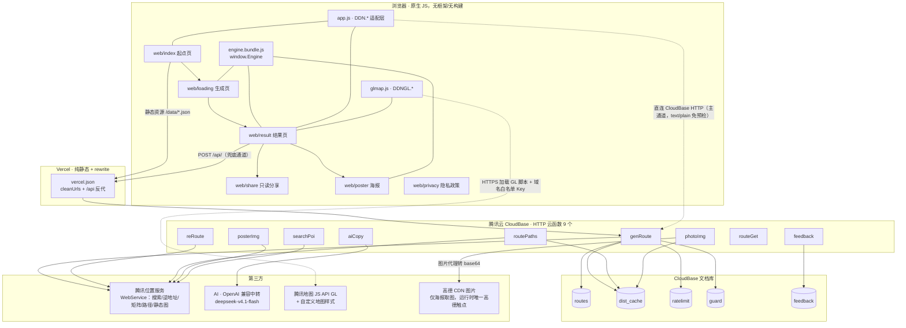

# 点定旅途 · 技术与工程素材（可核验版）

> 用途：简历 / 面试 / 项目复盘的「技术事实底稿」。所有结论尽量带 `文件:行号`；不能核验的数字单列在第 9 节。
> 仓库快照：`D:\Deep Seek Files\点定旅途`，HEAD `84cde7d`（作者日期 2026-10-18 23:34），工作区干净。
> 统计口径：行数为「物理行（含空行，按 `\n` 切分）」；另给非空行。排除 `node_modules/`、`build/`（后者被 `.gitignore:2` 忽略）。
> 红线：本文件不含任何密钥 / 凭据 / token；涉及 Key 的段落只写机制与存放位置。

---

## 1. 架构总图

### 1.1 一句话架构

**无构建、无框架的原生 JS 静态站（Vercel）→ 同源 `/api/<fn>` rewrite → 腾讯云 CloudBase 9 个 HTTP 云函数 → 腾讯位置服务（LBS）/ OpenAI 兼容 AI / CloudBase 文档库 5 个集合**；路线引擎同一份源码在浏览器与云函数双端复用。

### 1.2 拓扑（Mermaid）



### 1.3 数据流向（按用户链路）

| # | 链路 | 前端动作 | 服务端 / 外部 | 落点 |
|---|---|---|---|---|
| 1 | 打开页面 | 拉 `/data/cities.json`、`/data/spots/<city>.json` | Vercel/CloudBase 静态托管直出，不经云函数 | 无 |
| 2 | 起点搜索 | `searchPoi`（关键词 / 逆地址） | 腾讯 suggestion / geocoder | `ratelimit`、`guard` |
| 3 | 生成路线 | `genRoute`（9000ms） | 本地引擎 → 腾讯矩阵/路径回填通勤 → 落库 | `routes`、`dist_cache`、`ratelimit`、`guard` |
| 4 | 微调 / 改时间 | `reRoute`（6000ms） | 按显式顺序重算当天 + 真实通勤 | `dist_cache`、`ratelimit`、`guard` |
| 5 | 地图画真实路网 | `routePaths`（12000ms；海报 v2 改画概览曲线，不再调它） | 腾讯 direction → polyline 解压 → 抽稀 + 端头吸附 | `dist_cache`（path 键） |
| 6 | 海报底图 | `posterImg`（15000ms） | 腾讯静态图代理转 base64 | `dist_cache` 不存图，只计预算 |
| 7 | 海报景点图 | `photoImg`（14000ms，每批 12 张） | 高德 CDN 图 → base64（防 canvas 污染） | `dist_cache`（30 天） |
| 8 | 打开分享 | `routeGet`（6000ms） | 按 128 位 ID 读 `routes` | `routes` |
| 9 | 信息有误 | `feedback`（6000ms） | 只写库，不在页面展示 | `feedback` |

### 1.4 架构关键事实

- **Vercel 只做静态与反代**：`cleanUrls: true`、`trailingSlash: false`，页面全部 rewrite 到 `/web/*`，`/api/:fn` 反代 CloudBase HTTP 地址（`vercel.json:2-22`）。
- **前端有两级通道**：同源 `/api`，以及直连 CloudBase HTTP 服务；因 2026-10-18 实测 Vercel `/api` 偶发 502/超时，代码把**直连设为主通道、`/api` 设为兜底**（`web/assets/app.js:265-276`，对应提交 `d7b3636`/`1f6487c`）。直连用 `text/plain` 触发 CORS 简单请求，绕过 CloudBase HTTP 触发器对 `OPTIONS` 返回 400 的问题（`web/assets/app.js:283-289`）；云函数 `parseBody` 兼容 base64 body（`cloudfunctions/_shared/http.js:6-19`）。
- **云函数统一契约**：`exports.main`，响应 `{ statusCode, headers, body: JSON.stringify(...) }`，CORS `*`（`cloudfunctions/_shared/http.js:22-36`）；函数级 `timeout: 20`、`memorySize: 256`（`scripts/deploy-functions.js:53-54`）。
- **5 个集合各司其职**：`routes`（路线，无 TTL）、`dist_cache`（通勤/路径/图片缓存）、`ratelimit`（分钟级 IP 计数）、`guard`（腾讯日调用预算）、`feedback`（反馈）（`cloudfunctions/_shared/store.js:16-120`；`photoImg` 与 `routePaths` 也复用 `dist_cache`，见 `cloudfunctions/photoImg/index.js:42-58`、`cloudfunctions/routePaths/index.js:121-158`）。
- **双端同源引擎**：前端用生成物 `web/assets/engine.bundle.js`（906 行，`window.Engine`），云函数直接 `require('./engine/index')`（`cloudfunctions/_shared/routeKit.js:6`）。改 `engine/` 必须「重跑 bundle + 重部署 3 个函数」；`NEEDS_ENGINE = {genRoute, reRoute, aiCopy}`（`scripts/deploy-functions.js:17`、`scripts/build-engine-bundle.js:1-32`）。
- **数据与代码分离**：60 城 JSON 放站点根 `/data/spots/` 直出（`web/assets/app.js:7-28,71-85`）；云函数打包时把 60 城数据内嵌进 `genRoute/reRoute/aiCopy`（`scripts/deploy-functions.js:72-79`），单城按 `CITY_FILES` 白名单加载（`cloudfunctions/_shared/routeKit.js:10-40`）。
- **未启用**：无 PWA / Service Worker、无登录、无支付、无 UGC 发布、无定时任务（技术评估里的 `spotsSync` 定时刷新未落地），详见第 9 节。

---

## 2. 选型理由与取舍

### 2.1 为什么「无构建 / 无框架」

- **页面规模在框架收益线以下**：全站 6 页（`web/index|loading|result|share|poster|privacy.html`），静态资源合计 242,680 B ≈ 237 KB（含引擎 bundle 39,630 B）；首页首屏只需 `index.html + style.css + app.js + engine.bundle.js` ≈ 85 KB（未压缩，`web/` 实测字节），无框架运行时、无构建链、无字体外链。
- **原型直接生长为产品**：早期「技术可行性与架构评估」明确判断「本项目 4 个页面、交互中等，框架是负资产」，并保留后期迁 Vite 的口子（`技术可行性与架构评估.md:114`）。
- **自写 32 行打包器替代 bundler**：`scripts/build-engine-bundle.js` 给 3 个 CommonJS 模块套一层 `__mods/__req` 模块壳，输出单文件 bundle，不引第三方打包器（`scripts/build-engine-bundle.js:4,12-27`）。代价：bundle 不可手改（文件头写明自动生成，`web/assets/engine.bundle.js:1`），且没有类型检查/拆包。
- **代价与边界**：全局命名空间 `window.DDN` / `window.DDNGL`（`web/assets/app.js:3,408-419`；`web/assets/glmap.js:5`），DOM 直接操作；复杂度继续上升时应迁移框架，这一点在文档里被显式承认为技术债而非优点。

### 2.2 为什么引擎双端复用（bundle + require）

- **同一份排序/校验规则**：`validateInputs`、`genRoute`、`retimeDay` 在浏览器与云函数完全同源（`engine/index.js:707-728,568-698,452-454`）；这样「云端校验拦截」与「本地兜底」不会出现两套口径漂移，测试只需覆盖一份引擎（`engine/test.js`）。
- **云端失败可无感降级**：loading 页只在「网络/超时/5xx」时回退本地 `window.Engine.genRoute`，业务错误码（`CITY_CLOSED`/`ORIGIN_TOO_FAR` 等）直接展示、不回退（`web/loading.html:208-220`）；微调失败回退本地 `retimeDay`（`web/assets/app.js:326-356`）。
- **取舍**：数据必须两端各自可达——浏览器走 `/data/spots`，云函数走打包内嵌 JSON；引擎改动有「双端同步」纪律成本，靠 `NEEDS_ENGINE` 名单 + 两处检查清单兜住（`scripts/deploy-functions.js:17`、`项目上下文.md:79-80`）。
- **云端增量价值**：引擎本身不联网（`engine/index.js:2-4`），云函数在生成后用腾讯矩阵/路径把「直线估算」替换成真实通勤，并做真实分钟口径的二次排序（`cloudfunctions/_shared/routeKit.js:383-458`）；前端只拿结果，不重复实现。

### 2.3 为什么 HTTP 云函数，而不是小程序 / 自建后端

- **HTTP 触发器 = 静态站可直接调**：Vercel rewrite 与浏览器直连都只需要一个 URL；同一套接口同时服务主站与 CloudBase 备用站（`vercel.json:21`、`web/assets/app.js:268-276`）。
- **不绑微信生态**：无登录、无小程序审核链路，任何浏览器可达；与「无账号、无支付、无 UGC」的产品红线一致（`项目上下文.md:18-27`）。
- **免运维 + Key 隔离**：Key 只存在云函数环境变量（`cloudfunctions/_shared/lbs.js:3,16-17`；`cloudfunctions/aiCopy/index.js:20,26`），前端零 WebService Key；对比自建 VPS（运维与安全面更大）、SCF+COS（搭建成本更高），云开发在单人项目里是更小的总成本（`技术可行性与架构评估.md:115-116`）。
- **文档型数据足够**：`routes / dist_cache / ratelimit / guard / feedback` 全是 key-value/文档形态，无关系需求（`技术可行性与架构评估.md:116`）。
- **地图选型**：运行时只用腾讯（GL 动态地图 + 静态图海报），高德只在**离线建库**用（照片/坐标交叉校验），线上仅由 `photoImg` 代理其图片 URL、不调用高德 API，避免高德商用授权约 5 万元/年的成本炸弹（`技术可行性与架构评估.md:117`；`项目上下文.md:268-275`；`cloudfunctions/photoImg/index.js:9,40-41`）。
- **自定义地图样式是「配置即设计」**：54 项参数（背景面 14 + 背景线 5 + 道路 8 + POI 27）逐项定义「安静坐标纸」观感（`地图样式参数.md:9-87`）；生效需「控制台发布 + 绑定 GL Key + 代码传 mapStyleId」三件套（`web/assets/config.js:6`；`web/assets/glmap.js:73-77`）；静态图接口不支持自定义样式，海报只能用 canvas 滤镜逼近（`项目上下文.md:320-323`）。
- **AI 定位**：AI 是解释层，不是选址层；模型可切 deepseek/glm，失败一律回退（`cloudfunctions/aiCopy/index.js:10-22,103-119`）。

### 2.4 成本结构（估算，未拉账单）

| 项 | 结构 | 依据 / 备注 |
|---|---|---|
| 静态托管 | Vercel 静态 + CloudBase 静态托管（备用站） | 流量小，无独立 CDN 采购 |
| 云函数 | 按调用次数/资源用时计费，HTTP 触发器 | 9 个函数、256MB、20s；验证期 DAU 数十~数百（`技术可行性与架构评估.md:21`） |
| 腾讯 LBS | 免费配额内为主 | 单次路线外部调用 6~8 次（设计目标 ≤15），靠缓存压低 |
| AI | 按 token，deepseek-flash 级 | 叙事 60~110 字/次，且可降级为不显示 |
| 域名 | 已持有 | `decidenow.asia` |
| 备案 | **暂不备案** | 走 GitHub + Vercel 路径（`项目上下文.md:39`） |
| 总成本量级 | 估算 ≈ 240 元/年（云开发基础套餐） | 来自 `技术可行性与架构评估.md:104`，非账单实测 |

---

## 3. 云函数清单（实测 9 个）

> 口径说明：任务描述与部分文档写「8 个」，但仓库代码目录、部署脚本的 `ALL` 数组均为 **9 个**——`photoImg` 是 2026-10-18 海报 v2 新增（`scripts/deploy-functions.js:18`；提交 `7eca921`）。以下以代码为准。

### 3.1 函数总表

| 函数 | 职责 | 入参（截断/校验） | 出参 / 业务码 | 前端超时 | 降级策略 | 关键实现 |
|---|---|---|---|---|---|---|
| `genRoute` | 生成整条路线：校验 → 引擎排线 → 真实通勤回填 → 落库 | `{city, origin{name,lng,lat,spotId?}, days 1–5, startDate?, startNow?, nowMin?, startMin?}` | `200 {route, routeId}`；400 `CITY_CLOSED`/`SPOTS_EMPTY`/`ORIGIN_TOO_FAR`/`NOT_ENOUGH_SPOTS`/`PLAN_EMPTY`；429；500 | 9000ms | 引擎本身纯本地；通勤回填失败逐腿回退直线估算；落库失败 `routeId=null` 仍返回路线 | `cloudfunctions/genRoute/index.js:9-53`；校验 `:28-31`；`routeSave` `:48` |
| `reRoute` | 用户微调后按**显式顺序**重算当天，真实通勤 + 全量重校验 | `{city, origin, date, startMin?, stops:[{id,dur?}]≤8}` | `200 {items,dropped,stats}`；400 `CITY_CLOSED`/参数不完整；429；500 | 6000ms | 含自定义站点的当天前端不走云端（本地 `retimeDay`），避免未知 id 被静默丢弃 | `cloudfunctions/reRoute/index.js:10-37`；`stops.slice(0,8)` `:18`；`buildCommuteFn` `:27` |
| `aiCopy` | AI 只写解释性文案 / 从攻略文本提取景点 | `{kind:'narrative', route}` 或 `{kind:'extract', city, text≤500}` | **任何异常都 200 + `fallback:true`**；叙事 ≤110 字 | 叙事 6500ms / 提取 5000ms | 默认 3s、叙事 5s 超时；无 Key/超时/非 2xx/解析失败 → fallback，前端整行隐藏 | `cloudfunctions/aiCopy/index.js:24,45-75,77-101,103-119` |
| `routePaths` | 真实路网折线：direction → polyline 解压 → 抽稀 → 端头吸附 → 可信度校验 | `{legs:[{from,to,mode?}]≤24}`，`mode` 仅 walk/transit/drive | `{paths:[[[lat,lng]...]｜null,...]}`，与 legs 同序 | 12000ms（结果页地图；海报 v2 不再调用） | 单腿失败返回 `null`，前端画浅灰虚线（不冒充真实路网）；预算熔断时也返回 null | `cloudfunctions/routePaths/index.js:112-163`；几何 `:50-108`；缓存 `:121-158` |
| `posterImg` | 腾讯静态图代理，Key 不出云函数 | 白名单 11 参：`center,zoom,size,markers,paths,scale,maptype,format,labels,linkid,traffic`（每参 ≤1500） | `{base64,contentType}`；503 预算熔断；502 取图失败 | 15000ms | 失败前端回退「示意底图」（纸色 + 自绘） | `cloudfunctions/posterImg/index.js:9-26` |
| `photoImg` | 高德 CDN 景点图 → base64（跨域图会污染 canvas） | `{items:[{urls:[...]}], urls?}` ≤12 项，每项 ≤3 候选 | `{images:[{b64,type}｜null,...]}` | 14000ms | 单图失败为 null，海报用站名首字色块兜底 | `cloudfunctions/photoImg/index.js:19-65`；host 白名单 `:9,40-41`；420KB 上限 `:10` |
| `searchPoi` | 起点关键词提示 + 定位逆地址（城市判定） | `{keyword≤30, region≤10?}` 或 `{lat,lng}`；`region` 可空 = 全国提示 | 关键词 `{data:[...]}`；逆地址 `{city,address,adcode}`；**熔断/失败返 200 + `degraded:true` 空数组** | 首页 5000/6000ms、loading 8000ms、结果页 4000ms | 降级为空建议，前端回退本地景点库匹配 | `cloudfunctions/searchPoi/index.js:9-29` |
| `routeGet` | 只读分享页按 ID 读路线 | `{id}` 必须匹配 `^[0-9a-f]{32}$` | `{route}` 或 404 | 6000ms | 无降级；**无限频**（只读、成本低） | `cloudfunctions/routeGet/index.js:8-13`；`store.js:107` |
| `feedback` | 景点卡「信息有误」反馈落库 | `{spotId≤64?, routeId?, text≤500}`；routeId 必须 32 位小写 hex | `200 {saved:true}`；400 空内容/`BAD_ROUTE_ID`；429；500 | 6000ms | 只写库、不在页面展示；写失败返回 500 不抛异常 | `cloudfunctions/feedback/index.js:9-31`；截断 `store.js:114-120` |

### 3.2 公共模块（打包时注入到每个函数目录）

| 模块 | 职责 | 关键点 |
|---|---|---|
| `_shared/http.js` | 请求体解析、统一响应 | 非 JSON Content-Type 时 body 可能是 base64，先解码再 parse（`:6-19`）；`ok/fail` 统一 CORS（`:22-36`） |
| `_shared/lbs.js` | 腾讯 WebService 封装 | 模块级 200ms 节流、每请求最多 2 次尝试、单次 5s 超时；`status===121` 标 `quotaExceeded`（`:9-32`）；**单位坑：`direction` 的 duration 是分钟、`matrix` 是秒**（`:72,86`） |
| `_shared/store.js` | 限频、日预算、dist_cache、routes/feedback | 单 IP 20 次/分（`:18,27-41`）；腾讯日预算 12000 次、70% 告警（`:19-20,44-60`）；200m 网格缓存（`:63-90`）；128 位 routeId（`:92-112`） |
| `_shared/routeKit.js` | spots 加载 + 真实通勤回填 + 真实分钟排序 | `CITY_FILES` 60 城白名单（`:10-26`）；`validOrigin` 经纬度双校验（`:29-34`）；批量矩阵 + 公交逐段（`:47-126`）；Held-Karp 精确 TSP（`:234-279`）；交叉/折返惩罚（`:178-232,286-340`） |

### 3.3 错误码总览（前端可区分「业务错误」与「可回退故障」）

`CITY_CLOSED` / `SPOTS_EMPTY` / `ORIGIN_TOO_FAR` / `NOT_ENOUGH_SPOTS`（引擎校验，`engine/index.js:707-728`；`genRoute/index.js:14,31`）；`PLAN_EMPTY`（`genRoute/index.js:43`）；`BAD_ROUTE_ID`（`feedback/index.js:21`）；HTTP 层 400/404/429/500/502/503；前端只对「无业务码 / 5xx / AbortError」换通道或回退（`web/assets/app.js:279-317`、`web/loading.html:208-220`）。

---

## 4. 成本与配额控制（重点）

### 4.1 红线：单次路线生成 ≤15 次腾讯调用

来源：`技术可行性与架构评估.md:21`（预算 ≤15 次/次生成）、`项目上下文.md:24`（红线 #3）、`docs/route-planning-scheme.md:4,81`。落地靠四个机制：

1. **批量距离矩阵**：步行/驾车各自**只发 1 次** matrix，`froms/tos` 都取当天全部点，一次拿全 N×N 时长，并把整张矩阵写回缓存（`cloudfunctions/_shared/routeKit.js:72-92`）。`froms` 故意取「全部点」而非仅缺失腿：同一次调用顺带拿到全对时长，供排序复用、**不增加调用次数**（`:73-74` 注释）。
2. **起点 200m 网格缓存**：`gridKey = floor(v×500)/500` 即约 200m 网格；通勤键 `${gridKey}__${toId}__${mode}`；步行/驾车 TTL 7 天，公交当天 24:00；`transit2` 后缀用于让一次单位换算错误的旧公交缓存自然失效（`cloudfunctions/_shared/store.js:63-76`）。
3. **腾讯日预算硬闸门**：**每次**腾讯调用前都要 `await store.tencentBudget()`，超 12000 次/日即返回 false、调用方降级（矩阵/公交：`routeKit.js:77,96,398`；折线：`routePaths/index.js:136`；静态图：`posterImg/index.js:19`；搜索/逆地址：`searchPoi/index.js:15,24`）。达 70% 打告警日志（`store.js:52-55`）。
4. **单 IP 限频**：`IP_LIMIT_PER_MIN = 20`，键 `ip_<ip>_<UTC分钟>`，集合 `ratelimit`；只有 `routeGet` 不限频（`store.js:18,27-41`；`routeGet/index.js:8-13`）。

### 4.2 「一次生成最多几次外部调用」的账

**生成链路（genRoute）**：

| 环节 | 调用上限（按代码路径） | 说明 |
|---|---|---|
| 步行矩阵 | 每天 ≤1 次 | 仅当存在未缓存的步行腿（`routeKit.js:74-92`） |
| 驾车矩阵 | 每天 ≤1 次 | 同上；矩阵结果全量回写缓存 |
| 公交逐段 | 每未缓存公交腿 1 次 | 腾讯矩阵不支持 transit，只能 `direction` 逐段（`routeKit.js:94-102`；坑位记录 `项目上下文.md:820`） |
| 全对驾车矩阵补量 | 每天 ≤1 次 | 排序需要全对分钟但矩阵不全时补 1 次（`routeKit.js:395-416`） |
| **典型值** | **3 日冷缓存 6~8 次；缓存命中趋近 0** | 代码注释直接给出（`routeKit.js:3-4`）；红线出处见 `技术可行性与架构评估.md:21` |

**完整用户旅程（含生成之外）**：

| 环节 | 次数 | 依据 |
|---|---|---|
| 起点搜索建议 | 输入防抖后每次 ≤1；选中/回车不再额外请求 | `web/index.html:272-274` |
| 路线生成 | 6~8（冷）/≈0（热） | 上表 |
| AI 叙事 | ≤1（失败 0，重试无） | `web/result.html:1566-1576` |
| 路网折线 | 每腿 ≤1，单请求 ≤24 腿；7 天缓存 | `routePaths/index.js:115-158`；`web/result.html:703` |
| 海报底图 | 1~2（同页按 `center+zoom+size` 去重） | `web/assets/app.js:167-188` |
| 海报景点图 | `ceil(去重站点/12)` 次，每次最多 12 图 | `web/poster.html:172-176` |
| 分享读取 / 反馈 | 0 次腾讯调用 | `routeGet`/`feedback` 只读/写库 |

> **诚实结论**：`≤15` 是「设计目标 / 典型值」，不是代码里的硬上限——代码只按「每次调用前过日预算」与「20 次/分/IP」设闸；若某天全是 1.5~15km 的公交腿，理论上 3 天可超过 15（每天 2 次矩阵 + 9 条公交腿 + 1 次补量 ≈ 12/天）。写简历时建议表述为「典型 6~8 次、缓存命中趋近 0，单日总预算 1.2 万次熔断」，不要写「硬性 ≤15」。

### 4.3 AI 的 3s/5s 超时与降级

- 默认超时 **3s**（`cloudfunctions/aiCopy/index.js:24`）；叙事放宽到 **5s**（`:70`），前端给 6500ms（`web/result.html:1569`）。
- 无 Key → 直接返回 null（`:26-27`）；任何异常 → `200 {fallback:true}`（`:116-119`），**前端整行隐藏叙事、不显示模板文案**（`web/result.html:1561-1577`）。
- 提取类输出强制 `spots` 白名单过滤 + Set 去重，幻觉地名直接丢弃（`aiCopy/index.js:83-96`）。
- 成本上 AI 是可断的：断 AI 只少一段文案，不影响排线与地图。

### 4.4 缓存分层

| 层 | 键 / 介质 | TTL | 位置 |
|---|---|---|---|
| 浏览器内存 | `baseMapCache`（center+zoom+w×h） | 页面生命周期 | `web/assets/app.js:167-188` |
| 浏览器会话 | `ddn_request` / `ddn_route`（sessionStorage）、`ddn_shared`（localStorage） | 会话/长期 | `web/assets/app.js:106-113` |
| 通勤缓存 | `dist_cache`：`gridKey__toId__mode` | walk/drive 7 天；transit 当天 | `cloudfunctions/_shared/store.js:63-90` |
| 路网折线 | `dist_cache`：`lng4,lat4__lng4,lat4__mode__path` | walk/drive 7 天；transit 当天 | `cloudfunctions/routePaths/index.js:121-158` |
| 景点图 | `dist_cache`：`img__<hash(url)>` | 30 天 | `cloudfunctions/photoImg/index.js:11,42-58` |
| 静态资源 | Vercel / CloudBase 静态托管 | 平台默认 | `vercel.json` |

---

## 5. 安全与合规

### 5.1 Key 分层

| Key | 存放 | 暴露面 | 控制 |
|---|---|---|---|
| 腾讯地图 **JS API GL Key** | `web/assets/config.js:5`（仓库内，公开） | 浏览器可见 | 控制台配域名白名单（`web/assets/glmap.js:2-4`；`项目上下文.md:23,637`） |
| 腾讯位置服务 **WebService Key** | 云函数环境变量 `TENCENT_WS_KEY` | 不出云函数 | 代码只读 env（`cloudfunctions/_shared/lbs.js:3,16-17`）；部署脚本经 env 传入，临时配置写在 gitignored 的 `build/`（`scripts/deploy-functions.js:8,22-27,39-56`） |
| AI Key | 云函数环境变量（`DEEPSEEK_KEY`/`GLM_KEY`） | 不出云函数 | 同上；`aiCopy` 只读 env（`cloudfunctions/aiCopy/index.js:20,26`） |
| 高德 Key | **仅离线脚本**，命令行 env 传入 | 不进线上运行时 | `scripts/lib/amap.js` + `scripts/backfill.js`/`photos.js`；线上不调高德 API（仅 `photoImg` 代理其图片 CDN）（`docs/route-planning-scheme.md:80`） |
| CloudBase 凭据 | 本机 CLI 登录态 | 不入库 | npm 依赖只有 `@cloudbase/cli`（`package.json:1-5`） |

- 仓库是 **public**，因此只允许 GL Key 入库（且必须域名白名单），其余 Key 一律不得提交（`项目上下文.md:11,637`）。本文件不复制任何 Key 值。
- 残留风险：`build/cloudbaserc.json` 是部署时写入的**明文环境变量临时文件**（`scripts/deploy-functions.js:39-56`），虽被 `.gitignore:2` 排除，但共享目录时需手动清理。

### 5.2 分享 ID 与越权面

- `routeId = crypto.randomBytes(16).toString('hex')` → **32 位 hex = 128 位随机**，即 `routes` 文档 id；`routeGet`/`feedback` 都用 `^[0-9a-f]{32}$` 校验（`cloudfunctions/_shared/store.js:92-95,107`；`feedback/index.js:9,21`）。
- 分享页只读：拿到链接即可看（隐私政策明示），但不可写、不可枚举；无账号体系，因此没有水平/垂直越权面（`web/privacy.html:34`）。
- 无 TTL：`routes` 不设过期，`routeGet` 的「已过期」文案实现上不可达（`项目上下文.md:224`；`routeGet/index.js:11`）。

### 5.3 输入面与 XSS

- 服务端校验：起点经纬度范围（`routeKit.js:29-34`）、`days` 夹 1~5（`genRoute/index.js:16`）、`stops` ≤8（`reRoute/index.js:18`）、`legs` ≤24（`routePaths/index.js:115`）、静态图参数白名单 + 1500 字符截断（`posterImg/index.js:9,16`）、图片 host 白名单 + 420KB 上限（`photoImg/index.js:9-10,40-41`）、反馈 500 字（`store.js:117`）、搜索词 30 字（`searchPoi/index.js:20`）。
- 前端渲染：全站 **55 处 `textContent`、仅 1 处 `innerHTML`**，且该处是静态内联图标（`web/assets/app.js:65`）；AI 叙事用 `createTextNode` 追加并挂「由 AI 生成」标签（`web/result.html:1570-1574`）。
- CORS 是 `*`（`http.js:25,33`），限频取 `x-forwarded-for`（`store.js:22-25`）——它是**成本护栏，不是认证边界**，不能对外宣称「接口鉴权」。

### 5.4 合规

- **隐私政策页**：位置仅当次计算、不存轨迹；无账号；分享链接 128 位 ID 说明；AI 标识；数据来源与反馈入口（`web/privacy.html:28-40`）。
- **AI 标识**：叙事行显式「由 AI 生成」（`web/result.html:1573`）；排序/时间全部算法完成（`web/privacy.html:37`）。
- **地图数据标注**：「地图数据 © 腾讯位置服务」在地图角与海报角各一处（`web/result.html:749`、`web/poster.html:450`）。
- **无登录 / 无支付 / 无 UGC 发布**：反馈只落库不在页面展示（`项目上下文.md:18-27`；`项目上下文.md:696`）。
- **备案与国内访问**：主站 `https://www.decidenow.asia`（Vercel，纯静态 + rewrite），备用站为 CloudBase 静态托管（国内直连，首访有腾讯云风险提醒页）；**暂未 ICP 备案**，走 GitHub + Vercel 路径（`项目上下文.md:35-39`）。因为前端有直连 CloudBase 的通道，备用站在没有 Vercel 的情况下也能完成「生成 / 微调 / 分享」（`web/assets/app.js:268-276`）。
- 简历/对外材料不应写「已备案」「已通过算法备案」「已获腾讯地图商用授权」——这三件事都没有证据，见第 9 节。

---

## 6. 工程质量

### 6.1 测试资产（可运行、失败非零退出）

| 资产 | 规模 | 覆盖 | 依据 |
|---|---|---|---|
| 引擎回归 `engine/test.js` | 277 行 | 校验器覆盖天数一致、时间不重叠、`dep>arr`、营业时间硬约束、周一闭馆不排入、每日收束、远郊不混日、锚点必为 D1 首站、空日防御等；14 组场景 + D（微调重推演）/G（校验三规则）专项块；失败 `exit 1` | `engine/test.js:14-86,114,214,240,276-277` |
| 云函数回归 `scripts/test-functions.js` | 233 行、**37 项断言**（`check(` 共 38 处，含 1 处函数定义） | 按部署同款规则 `--stage-only` 打包 → `require.cache` 预置 `store`/`lbs` stub → 断言业务码、限频 429、`stops:[]` 空日契约、落库失败 500、routePaths 抽稀/吸附纯函数、routeKit 排序守卫 | `scripts/test-functions.js:22-71,73-233` |
| 排序 QA 基线 `scripts/qa-order.js` | 33 行 | 12 城 × 1/3/5 天，统计开放路径最优率/回摆数/跨区日；当前基线 87 天、回摆 14、跨区日 0、平均差 2.37km | `docs/route-planning-scheme.md:173` |
| 60 城 QA | 脚本执行记录 | 60 城 × 1/3/5 天规划 0 问题 | `项目上下文.md:726` |
| 无头浏览器验收 | `build/` 下 167 个 js（调试/验证脚本与旧版快照混杂）+ 140 张 png（gitignored） | CDP 截图逐项验收 UI/地图/海报 | `build/` 实测；不进仓库，只能作过程佐证 |

### 6.2 部署流程

```text
改 engine/ ──► node scripts/build-engine-bundle.js   （生成 web/assets/engine.bundle.js）
            └► node scripts/deploy-functions.js genRoute reRoute aiCopy   （每个函数打包 _shared + engine + data）
改 web/    ──► CloudBase hosting deploy web / + git push（Vercel 自动构建，约 75s）
```

- 打包规则固化在脚本里：`_shared/*` 注入所有函数；`routeKit.js` 只进 `genRoute/reRoute/aiCopy`；这 3 个函数额外带 `engine/*.js` 与 60 城 `data/spots/*.json`（`scripts/deploy-functions.js:60-80`）；`--stage-only` 只打包不部署，供本地回归（`:19,83`）。
- 本地预览 `node scripts/serve.js [端口=8130]` 复刻 `vercel.json` 路由并把 `/api` 代理到 CloudBase（`scripts/serve.js:2-14,21-47`）。
- 发布顺序与运维要点见 `项目上下文.md:641-667`（含 `cleanUrls` 308 跳转、Windows/MSYS2 的 `tcb` 参数注意事项）。

### 6.3 一致性风险（面试可主动讲，属于「知道坑在哪」）

1. **引擎 bundle 与云函数可能不同步**：改 `engine/` 后忘跑 bundle 或忘部署 3 个函数，会出现「本地新、云端旧」（`项目上下文.md:79-80,819`）。
2. **三处城市白名单**：前端 `SPOT_FILES`（`web/assets/app.js:7-28`）、云函数 `CITY_FILES`（`routeKit.js:10-26`）、`data/cities.json` 的 `status`；任一漏改会出现「页面能选、云端 `CITY_CLOSED`」（`项目上下文.md:384-388`）。
3. **本地/云端排序口径不同**：引擎用直线距离，云端再用真实分钟排序；两者结果天然可能不同，对比时必须统一目标函数（`项目上下文.md:828`；`docs/route-planning-scheme.md:144-155` 记录了「先远后近」根因与修复）。
4. **落库失败静默**：`routeSave(...).catch(()=>null)` 返回 `routeId:null`，分享退化为本地手递手预览（`genRoute/index.js:48`；`web/result.html:1319-1320`）。
5. **文档与代码漂移**：多处写「8 个云函数」，实际 9 个；`项目上下文.md:675` 写「23 项通过」，实际 37 项断言；`项目上下文.md:382` 仍写「done 恰为 6 城」，实际 `cities.json` done=60。以代码为准。
6. **构建产物不可手改**：`engine.bundle.js` 首行注明自动生成（`web/assets/engine.bundle.js:1`），手改会被下一次构建覆盖。

### 6.4 Git 工程统计

- **128 次提交、7 个自然日**（首个 `2026-10-12 12:47` → 末个 `2026-10-18 23:34`，作者日期；`git rev-list --count HEAD = 128`）；单日提交 7 / 11 / 9 / 6 / 12 / 29 / 54（`git log --date=short` 分组）。
- 提交信息混合风格：`docs:` 12 次，其余多为中文动词短语；不应宣称「全部遵循 Conventional Commits」。
- 增量统计 `430,108 insertions / 88,804 deletions`——**包含大量景点 JSON**，不能当「纯代码量」引用。

---

## 7. 工程量化表（20 条以内，每条注明口径）

| # | 指标 | 数值 | 统计口径 |
|---|---|---|---|
| 1 | Git 提交总数 | **128** | `git rev-list --count HEAD` |
| 2 | 开发跨度 | **7 个自然日**（10-12 → 10-18） | `git log` 作者日期首末；非日历工期 |
| 3 | 每日提交 | 7 / 11 / 9 / 6 / 12 / 29 / 54 | `git log --date=short` 分组计数 |
| 4 | 跟踪文件总数 | **474** | `git ls-files` |
| 5 | 代码文件数 | **49**（js 42 / html 6 / css 1） | 排除 `data/`、`build/`、`node_modules/` |
| 6 | 代码物理行 | **10,930 行**（非空 10,352） | `.NET ReadAllText` 按 `\n` 切分；含空行 |
| 7 | 引擎 | 4 文件 / **1,163 行** | `engine/index.js` 730、`test.js` 277、`copy.js` 83、`geo.js` 73 |
| 8 | 云函数 | 13 文件 / **1,267 行** | 9 个函数入口 + 4 个 `_shared` 模块 |
| 9 | 前端 | 11 文件 / **5,337 行** | 6 个 HTML（3,290 行）+ 4 个 JS + 1 CSS |
| 10 | 离线脚本 | **22 文件 / 3,163 行**（21 js + 1 ps1） | `scripts/`，含 `lib/amap.js`、`amap-batch.ps1` |
| 11 | 页面数 | **6** | `web/*.html`；其中 `result.html` 1,581 行最大 |
| 12 | 云函数数 | **9** | `cloudfunctions/` 目录 / `deploy-functions.js:18` 的 `ALL` |
| 13 | CloudBase 集合 | **5** | `routes / dist_cache / ratelimit / guard / feedback` |
| 14 | 数据规模 | **60 城 / 2,713 景点** | `data/cities.json` 的 `status=done`；60 个城市 JSON 的 `spots` 求和（min 24 / max 64） |
| 15 | 数据体积 | 60 城 JSON **4.58 MB**；`data/` 全量 8.5 MB | 文件字节求和；部署时会内嵌进 3 个云函数 |
| 16 | 第三方接口封装 | **5 类** | suggestion / reverseGeocode / matrix / direction / staticMapBuffer（`lbs.js:98`） |
| 17 | 单次生成外部调用 | **典型 6~8 次**（3 日冷缓存），缓存命中≈0 | `routeKit.js:3-4`；设计红线见 `技术可行性与架构评估.md:21`；非硬上限，见 §4.2 |
| 18 | 前端接口超时 | 4s / 5s / 6s / 6.5s / 8s / 9s / 12s / 14s / 15s | 按调用点分散设置（`web/index.html:274,349`；`web/loading.html:146,212`；`web/assets/app.js:303,321`；`web/result.html:703,819,1236,1269,1569`；`web/poster.html:176`） |
| 19 | 云端超时 / 内存 | **20s / 256MB** | `scripts/deploy-functions.js:53-54` |
| 20 | 限频 / 日预算 / 分享 ID | 20 次/分/IP；12,000 次/日；128 位 | `store.js:18-20,92-95` |

补充（不计入 20 条）：LBS 单请求 5s ×2 次尝试（`lbs.js:24`）、静态图 8s（`lbs.js:93`）；AI 3s/5s；限频告警阈值 70%（`store.js:20,52`）。

---

## 8. 技术 → 产品语言翻译（用于简历/面试表述）

| # | 技术事实 | 用户/业务价值（可直接说） |
|---|---|---|
| 1 | 双端同源引擎（bundle + `require`） | 云端失败时浏览器用同一份引擎本地兜底，用户无感，不会看到「生成失败」 |
| 2 | 无框架无构建（6 页 / 首屏约 85KB） | 打开快、弱网和低端机也能用；没有框架升级与构建链维护成本 |
| 3 | 批量距离矩阵 + 200m 网格缓存 | 单次生成只打 6~8 次外部接口（典型），把第三方免费配额用在「新起点」上，成本可控 |
| 4 | 真实路网通勤回填（矩阵/路径） | 时间轴上的「步行/公交/打车 X 分钟」是真实路况数据，不是直线拍脑袋 |
| 5 | 真实分钟上的精确 TSP（Held-Karp）+ 交叉/折返惩罚 | 路线「不绕、不回头」；同起点同点集实测 D1 开放路径 28.8km → 14.2km |
| 6 | 抽稀 + 端头吸附 + 假几何识别 | 地图上的线是真实道路，且首尾接得到景点；宁可画虚线也不画穿湖假线 |
| 7 | AI 只写解释层 + 白名单过滤 | 排序永远可解释、可复现；AI 编不出不存在的景点/价格/营业时间 |
| 8 | AI 3s/5s 超时 + fallback | AI 挂了页面照常可用，只是少一段推荐语，不阻塞生成 |
| 9 | 128 位不可猜测分享 ID | 分享链接可以放心发；别人拿到链接只能只读查看，不能改你的路线 |
| 10 | 多层缓存（浏览器/会话/通勤/路径/图片） | 第二次打开同一路线几乎即时；重复生成不重复烧配额 |
| 11 | 限频 20/分 + 日预算 1.2 万熔断 | 即使被刷，也不会一夜之间把第三方额度跑光，服务可持续 |
| 12 | 全站 textContent + 单一静态 innerHTML | 用户输入与 AI 文案不会变成 XSS；公开仓库也不担心前端注入 |
| 13 | 9 个 HTTP 云函数 + Key 只在环境变量 | 前端零密钥；公开仓库里没有可被滥用的后端凭据 |
| 14 | Vercel + CloudBase 双站、API 双通道 | 一个入口挂了两条通路，主站/备用站都能生成与分享，国内访问有备胎 |
| 15 | 一套可跑回归（引擎 + 云函数 + QA 基线） | 改排序/改地图后能自动发现回归，不是「看着差不多就上线」 |

---

## 9. 存疑项（不可验证 / 不宜写进简历）

1. **「单次生成 ≤15 次腾讯调用」不能证明为硬约束**：代码里没有 per-request 上限，只有日预算 + IP 限频；典型 6~8 次是注释与设计文档口径。简历写「典型 6~8 次、日预算熔断」更稳。
2. **性能数字（首屏 <1.5s、生成 p50 600ms/p95 2s）来自设计评估而非生产监控**：`技术可行性与架构评估.md:80-83` 是预估；仓库无埋点/APM，不能引用为实测。
3. **成本数字（≈240 元/年等）是估算**：没有云账单截图或用量导出；面试被追问「真实花了多少」时只能答「免费额度内，量级百元/年」。
4. **用户量 / DAU / 转化 / 完成率全部无数据**：`web/` 无任何埋点/统计上报脚本（仓库也未见 analytics 接入），不能写「服务 xx 用户」。
5. **备案状态**：明确「暂不备案」（`项目上下文.md:39`）；不能写「已备案」「国内合规上线」。国内可访问性依赖 CloudBase 域名与风险提醒页，不能写「已解决国内访问」。
6. **AI 合规**：模型走第三方 OpenAI 兼容中转（`aiCopy/index.js:13-21`，`AI_BASE_URL` 为 env），仓库里没有生成式 AI 服务备案/算法备案材料；只能写「页面有 AI 标识 + 内容白名单约束」，不能写「已完成大模型备案」。
7. **腾讯地图商用授权**：个人开发者配额与条款是风险项（`技术可行性与架构评估.md:105,125`）；不能写「已获商用授权」。
8. **云函数数量口径**：任务/文档写 8 个，代码与部署脚本为 9 个（多 `photoImg`）；引用时注明口径，避免被面试官按仓库核对时对不上。
9. **测试数量口径**：文档写「23 项通过」，当前为 37 项断言；若简历写测试数，需按快照重跑 `node scripts/test-functions.js` 后再引用（本文件未运行，因任务限定只读）。
10. **10-19 的工作记录与 Git 作者日期有边界差**：`docs/route-planning-scheme.md`、`项目上下文.md` 记录到 2026-10-19 的改动，但 HEAD 作者日期停在 10-18 23:34；写简历用「一周内 128 次提交」这类可核验口径，不写精确到某天的功能上线日期。
11. **Git 增量 43 万行不可当代码量**：主要是 `data/spots` JSON（全量 8.5MB），代码物理行以 10,930 为准。
12. **`build/` 里的验收脚本与截图不在仓库**（gitignored）：它们能证明做过无头浏览器验收，但别人 clone 仓库看不到；对外应说「过程验收」，不能作为可复现工程资产。
13. **60 城质量不齐**：`kashi` 仅 24 个景点、`chongqing` 64 个；「60 城 2,713 景点」是可核验总量，但不能暗示每城体验一致；文档也明确 38 个新城的 FAME 名单是自动种子待人工复核（`项目上下文.md:784`）。
14. **「真机验证」证据仅文档自述**：`项目上下文.md` 提到真机/千元机检查，但仓库无测试报告；简历可写「做了 iOS/Android/微信内置浏览器三端检查」需自行确认确实执行过。
15. **未落地项不要写**：PWA/Service Worker、定时 `spotsSync` 30 天刷新、CDN/EdgeOne、登录/账号、支付、UGC、多语言均未实现（`技术可行性与架构评估.md:50-54` 是演进计划，不是现状）。
